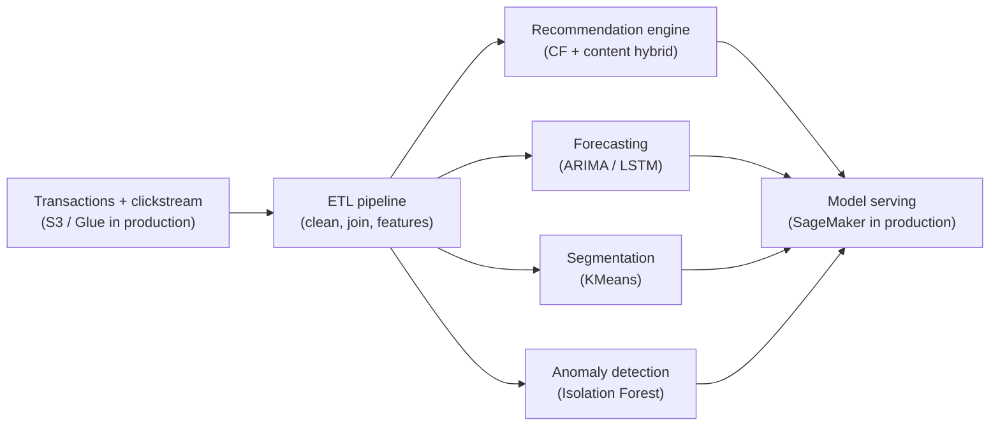

# AI-Powered Personalized Shopping — E-Commerce Platform

A clean-room demonstration of the AI platform I built at Deloitte India
for a high-traffic e-commerce operation: ETL pipelines, a hybrid
recommendation engine, demand forecasting, customer segmentation, and
anomaly-based fraud detection.

> **What this repo is:** a from-scratch re-implementation of the
> platform's architecture and modeling approach, running on synthetic
> data. It contains no employer code, no customer data, and no
> production artifacts. Production outcomes below describe the
> production system; demo results describe this repo's synthetic-data
> runs.

## Production context

In production, Python ETL pipelines integrated transactional systems,
clickstream logs, and customer interactions into clean training data.
A real-time recommendation engine (collaborative + content-based
filtering) lifted engagement and cart conversions; LSTM and ARIMA
forecasts optimized inventory; clustering powered targeted campaigns;
anomaly detection flagged payment fraud. Models served on AWS SageMaker
with A/B testing and Power BI dashboards for stakeholders.

Reported production outcomes:

- **~$1.8M saved annually** from reduced cart abandonment and higher conversions
- **Inventory holding costs down 25%** from demand forecasting
- **Marketing ROI up 30%** from segmented campaigns
- Fraud losses reduced via real-time anomaly detection

## Demo results (synthetic data, measured)

- **ETL:** 300 products, 19,995 clean orders from 2,000 users →
  2000×300 user-item matrix, mean spend $900 per user
- **Recommendations:** hybrid collaborative + content-based filtering,
  **precision@5 of 0.074** on a time-based holdout (random baseline
  ~0.017) — the pipeline shape matters more than the absolute number
  on sparse synthetic data
- **Forecasting:** 30-day holdout MAE — **seasonal ARIMA 11.7** vs naive
  last-value forecast 31.8 (LSTM variant runs when torch is installed)
- **Segmentation:** 4 clusters, from low-spend occasional buyers
  (~$215 mean spend) to high-value buyers (~$1,600 mean spend)
- **Fraud detection:** Isolation Forest flags 2.0% of payments with
  precision 0.40 / recall 0.43 against synthetic ground truth

Reproduce with `python src/etl.py`, `python src/recommend.py`,
`python src/forecast.py`, `python src/segment.py`,
`python src/anomaly.py`.

## Architecture



## Run it

```bash
pip install -r requirements.txt
python src/etl.py
python src/recommend.py
python src/forecast.py
python src/segment.py
python src/anomaly.py
python -m pytest tests/ -q
```

## Project structure

```
src/
  etl.py          synthetic catalog/orders/clicks, cleaning, user-item matrix
  recommend.py    item-item CF + TF-IDF content hybrid, precision@k eval
  forecast.py     seasonal ARIMA + optional PyTorch LSTM, holdout MAE
  segment.py      KMeans behavioral segmentation + cluster profiles
  anomaly.py      Isolation Forest payment-fraud demo
tests/
  test_smoke.py   pipeline, recommendation, forecast, segment, anomaly checks
```

## Tech stack

Python, Pandas, scikit-learn, statsmodels (ARIMA), PyTorch (optional
LSTM) — demonstrating the production Python / SageMaker platform in
runnable, dependency-light form.

## License

MIT
